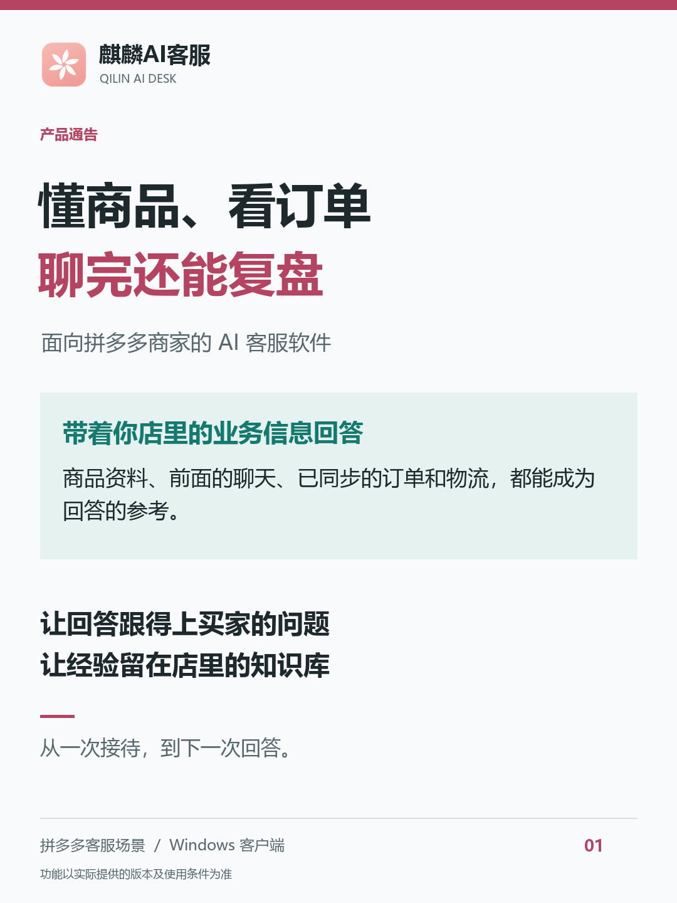
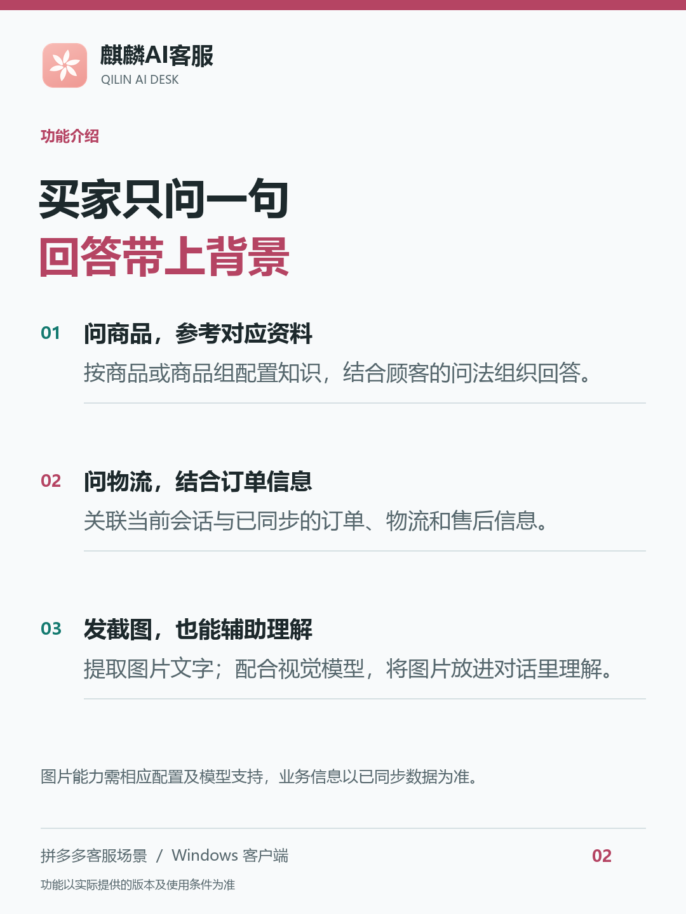
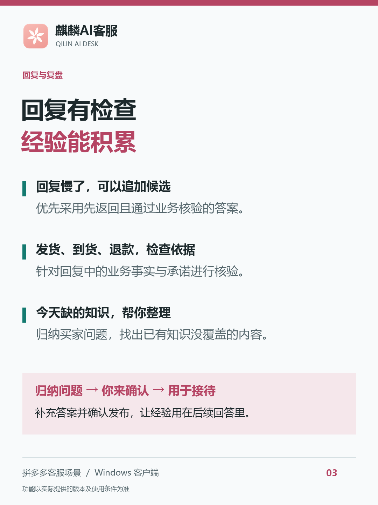

# 麒麟AI客服｜把你的店铺经验，变成 AI 的接待能力

面向中小拼多多商家的 Windows AI 客服软件，支持独立浏览器指纹环境与自定义代理出口 IP。

## 下载 Windows 安装包

**[下载麒麟AI客服 EXE 安装包](https://github.com/yunyar/qilin-ai-desk/releases/download/v1.4.27-recovered/qilin-ai-desk-1.4.27-recovered-windows-x64.exe)**

[全部版本与下载文件](https://github.com/yunyar/qilin-ai-desk/releases) · [使用问题与反馈](https://github.com/yunyar/qilin-ai-desk/issues)

- 版本：`1.4.27-recovered`
- 系统：Windows x64（64 位）
- 文件：`qilin-ai-desk-1.4.27-recovered-windows-x64.exe`，331,371,117 字节（约 331 MB）
- 使用方式：下载安装包，按界面提示完成安装、登录和店铺配置，再配置适用的商品知识与回复规则。
- 下载提供安装包；实际可用功能及使用条件以客户端展示和所提供服务为准。

## 产品介绍



买家只发来一句“怎么还没到”，客服背后要做的事可不少：找到订单、核对发货状态、看物流走到哪一步，再接上前面聊过的内容。

商品咨询、截图追问、退货退款，也是一样。**一段有用的回答，背后得有商品知识、业务信息和处理分寸。**

麒麟AI客服围绕这套接待过程来设计：让 AI 参考你店里的商品、会话和已同步业务数据，生成回答、检查依据，再把接待中发现的知识缺口整理出来。

**一、顾客只问一句，AI 能参考整件事的前因后果。**

“这个呢？”“什么时候到？”“退回去了。”

买家习惯接着上文说，很少把商品、订单和问题重新交代一遍。麒麟可以结合前面的聊天、当前关联的商品、订单、物流及售后记录组织回答。商品咨询参考商品资料，物流追问参考已同步的物流信息，售后沟通结合相应业务状态。

**客服在聊天、订单和物流页面之间找依据的过程，被接进了同一套回复流程。**

**二、同一句“能水洗吗”，换个商品，就该换份资料。**

店里有几十款商品，材质、规格、用法各不相同。让 AI 熟悉你的店，得先让它拿到适用的知识。

麒麟支持给商品分别关联知识，也支持一组商品共用说明。同类商品的共通内容一起维护，有差异的部分单独配置。AI 再结合买家的问法组织语言，商品知识就能用到具体对话里。



**三、买家发一张截图，再补一句话，也能一起理解。**

真实接待里，买家经常直接发图：“你看这个。”“这里是什么意思？”

麒麟支持提取图片里的文字；配合支持图片理解的模型，还能把图片和前后对话一起交给 AI 参考。接待可以顺着买家的表达方式往下走，截图里的信息也能参与回答。

**四、发货、到货、退款，开口之前先检查依据。**

“今天发货。”“明天送到。”“这笔可以退。”

这些话说出去，就可能变成店铺的承诺。麒麟在回复流程中加入业务事实与风险核验，检查具体说法有没有相应依据。发现问题可以要求 AI 改写，需要进一步确认的内容留作草稿，交给人工判断。

**把“这句话有没有依据”也纳入接待流程，是为了让商家更有把握地使用 AI。**

**五、回复等得久了，系统还有后手。**

麒麟支持在等待较久时追加 AI 候选回答，优先采用先返回且通过核验的答案。

响应等待和回复检查，被放进同一套调度里考虑。对关心稳定接待的商家来说，这也是值得实际体验的一处细节。

**六、一天接待结束，还能帮你列出“该补哪些知识”。**

“能机洗吗？”“洗衣机能洗不？”问法不同，可能说的是同一件事。店铺每天接待这么多消息，哪些反复出现、哪些还缺答案，逐条翻记录很费心。

麒麟可以按商品归纳问题，合并意思相同的问法，再检查已有知识能否覆盖，把值得补充的问题整理出来。你补充答案并确认发布后，这些经验就能用于后续接待。

**今天遇到的问题，可以一步步变成店里积累下来的接待能力。**

**七、多店铺独立环境，出口 IP 也能自己配置。**

多店铺接待，账号环境和网络出口同样需要安排。麒麟支持为每个账号配置独立的浏览器指纹环境、浏览器进程和数据目录，分别保存 Cookie 与登录状态。

网络可以选择本机直连，也可以给不同账号分别配置 HTTP/SOCKS5 代理，使用自己准备的代理出口 IP。支持检测实际出口、校验预期 IP；启用出口绑定校验后，发现不一致会阻止启动或相应操作并提示。

**店铺用哪套浏览器环境、走哪个代理出口，都可以分别设置。**



多家店铺还可以分别配置回复规则与 AI 设置，会话和回复记录方便回看，按各自的商品和服务要求安排接待。

**麒麟AI客服：让回答带着业务依据，让每天的接待留下经验。**

了解麒麟，建议直接拿你店里常见的商品咨询、物流追问和售后问题试一试。看它能不能用上对应商品的知识，能不能结合订单信息回答，遇到需要确认的承诺又怎么处理。

把你熟悉的问题拿来体验，才更容易看清它适不适合你的店。点击页面上方的下载入口获取 Windows 安装包，安装后按界面提示完成登录与配置。

当前介绍范围为拼多多客服场景与 Windows 客户端；业务信息以实际关联和已同步的数据为准，图片能力需相应配置及模型支持，具体功能以实际提供的版本为准。重要业务承诺由人工确认。

麒麟AI客服


## 下载文件校验

EXE 安装包的 SHA-256：

```text
bc836ec1ba096ecb04b9b48e175f30d350ff80ee93b8e0adcbf265fc38f12760
```

可在 PowerShell 中执行：

```powershell
Get-FileHash -Algorithm SHA256 "qilin-ai-desk-1.4.27-recovered-windows-x64.exe"
```

本仓库用于产品介绍与安装包分发。
